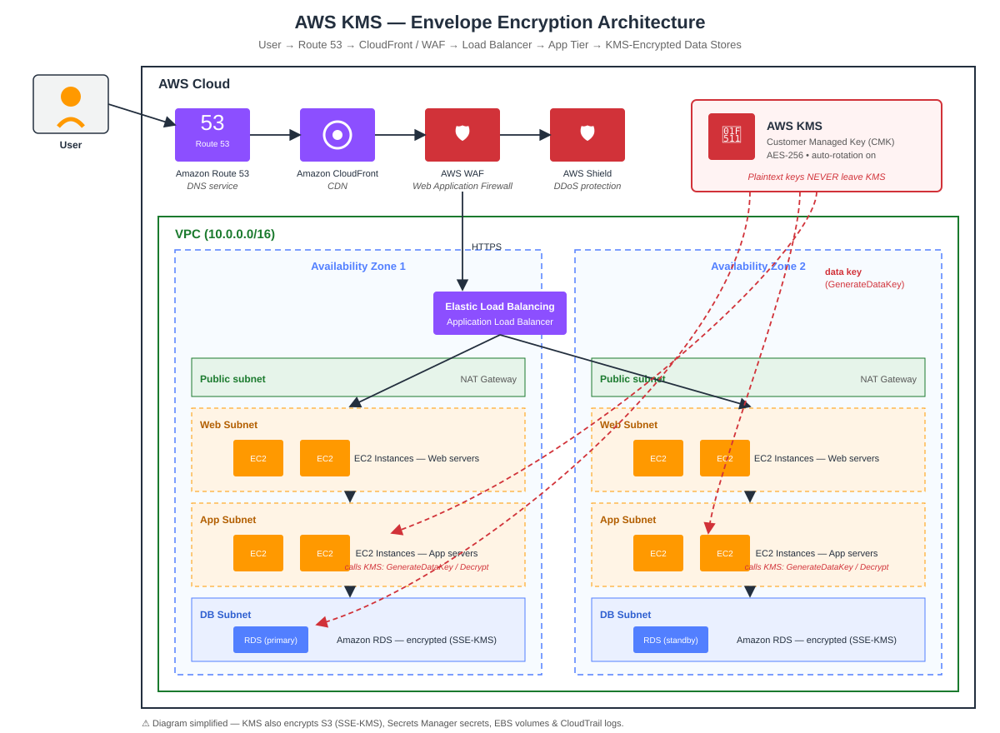

# AWS KMS Encryption Guide 🔐


> **TL;DR:** AWS KMS never lets your plaintext keys leave the service. You encrypt a *data key* with KMS, encrypt your data locally with that data key, and store the encrypted data key next to the data. That pattern — **envelope encryption** — is the foundation of almost every encrypted AWS service.

---

## Why KMS Matters

| Problem | Without KMS | With KMS |
|---|---|---|
| Key storage | Keys in code / env vars 😱 | Keys live in FIPS 140-2 HSMs |
| Key rotation | Manual, error-prone | Automatic yearly rotation |
| Audit trail | "Who decrypted what?" — unknown | Every use logged to CloudTrail |
| Cross-account access | Shared secrets over Slack | Key policies + grants |
| Revocation | Redeploy everything | Disable the key — access stops instantly |

## How Envelope Encryption Works

```
┌──────────────────────────────────────────────────────────────┐
│ 1. GenerateDataKey → KMS returns:                            │
│    • Plaintext data key (use it, then discard from memory)   │
│    • Encrypted data key (store this with your data)          │
│ 2. Encrypt data locally with the plaintext data key (AES-GCM)│
│ 3. Store: ciphertext + encrypted data key                    │
│ 4. Decrypt: KMS decrypts the data key → decrypt data locally │
└──────────────────────────────────────────────────────────────┘
```

KMS only ever sees the 32-byte data key — never your actual data. That keeps KMS fast, cheap, and safe.

## Architecture



**Traffic / key flow:** User → Route 53 → CloudFront / WAF → Application Load Balancer → EC2 app tier (in private subnets across 2 AZs) → RDS (encrypted with a KMS key). The app tier calls KMS to generate and decrypt data keys; encrypted objects land in S3 (SSE-KMS) and secrets in Secrets Manager (KMS-encrypted).

## Key Types — Pick the Right One

| Key type | When to use it | Rotation |
|---|---|---|
| **AWS managed key** (`aws/s3`, `aws/rds`…) | Default encryption for a service | Automatic, AWS-controlled |
| **Customer managed key (CMK)** | You need key policies, grants, rotation control, cross-account | Automatic yearly (optional) |
| **AWS owned key** | Service-internal encryption you never touch | AWS-controlled |
| **Multi-Region key** | Same key material in several Regions (DR, global apps) | Per-Region, manual sync |
| **External key store (XKS)** | Keys must stay in your own HSM | You control everything |

## Key Policies vs IAM vs Grants

```
Key policy   → the ONLY policy that can grant access to a KMS key.
                (IAM alone is NOT enough — the key policy must allow it.)
IAM policy   → grants the *permission* to call KMS, scoped by key ARN.
Grant        → temporary, scoped delegation (e.g. "this EC2 role may
                Decrypt with this key for the next 2 hours").
```

**Golden rule:** if `Decrypt` fails with `AccessDenied`, check the **key policy first**, then IAM.

## Rotation & Deletion — The Two Things People Get Wrong

- **Rotation** only rotates the *key material* — old ciphertext still decrypts, because KMS keeps every old version. Safe to enable everywhere.
- **Deletion** is scheduled (7–30 days, default 30). During the waiting period the key is disabled and **all data encrypted with it becomes unreadable**. There is no undo after the window closes. Set a CloudWatch alarm on `KMS key deletion` events.

## Cost Cheat Sheet (us-east-1)

| Item | Price |
|---|---|
| Customer managed key | $1 / key / month |
| API request (Encrypt, Decrypt, GenerateDataKey…) | $0.03 / 10,000 requests |
| Automatic rotation | Free |
| AWS managed / owned keys | Free |

> 💡 **Cost trap:** a chatty app calling `Decrypt` per request can quietly cost more than the keys themselves. Cache decrypted data keys in memory (with a TTL) instead of calling KMS every time.

## Code

[`kms_envelope_encryption.py`](kms_envelope_encryption.py) — a complete, runnable demo:

- `encrypt_file()` / `decrypt_file()` — envelope encryption with AES-256-GCM
- `encrypt_with_context()` — encryption context binds ciphertext to its purpose
- `create_key_with_rotation()` — CMK + automatic rotation + least-privilege key policy
- `grant_access()` — temporary grant for another IAM role

```bash
pip install boto3 cryptography
python kms_envelope_encryption.py --demo
```

## Quiz

Think you got it? [Take the 5-question quiz →](quiz.md)

---

## Checklist

- [ ] Use a customer managed key for anything sensitive (not the AWS managed default)
- [ ] Enable automatic rotation on every CMK
- [ ] Key policy: least privilege, no `"Principal": "*"` without conditions
- [ ] CloudTrail logging on + alarm for `DisableKey`, `ScheduleKeyDeletion`
- [ ] Encryption context on every `Encrypt` call (ties ciphertext to its use)
- [ ] Cache data keys — never call KMS per request in a hot path
